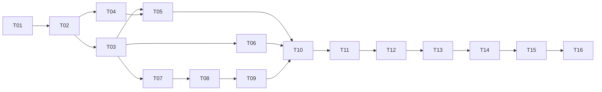

# 第一版任务包索引

当前阶段：主管规划。下表所有实现任务均为**未开始**；文档已生成不代表 App 已实现或测试通过。

项目根目录：`C:\Users\user1\Desktop\workspace\NEW TRY\life-log-android`。

## 使用方式

1. 主管先确认直接前置任务已验收、相关提交已进入当前基线，再分配一个任务包。
2. 用户另开实现对话，复制对应任务文件开头的提示词；该对话只负责该包。
3. 实现对话读取 `AGENTS.md`、`docs/WORKFLOW.md`、本包、相关规范章节及直接前置交接文件即可，不要求重新阅读全部聊天。
4. 完成后提交本包变更，填写本包独享的 `docs/handoffs/Txx.md`，报告提交、检查证据和未解决事项。
5. 主管核对代码和证据后统一更新 `docs/STATUS.md`；实现对话不改中央状态。

默认严格按 T01 → T16 串行执行：**一个工作目录同时只允许一个写入对话**。表中的依赖表示最低技术依赖，不是允许同时改同一工作目录的授权。需要并行时，由主管另行安排独立 worktree/分支，并确保直接前置已合入；不自动创建对话或 worktree。具体规则以 [WORKFLOW.md](WORKFLOW.md) 为准。

## 任务列表

S/M/L 是经验工作量与风险标记，定义见 `WORKFLOW.md`；不是 token 上限或工时保证。

| 编号 | 工作包 | 直接前置 | 规模 | 状态 | 独享交接文件 |
|---|---|---|---|---|---|
| [T01](tasks/T01.md) | 开发环境与可构建空安卓工程 | 无 | M | 未开始 | `handoffs/T01.md` |
| [T02](tasks/T02.md) | 领域、数据库与 Room 契约 | T01 | L | 未开始 | `handoffs/T02.md` |
| [T03](tasks/T03.md) | 主题与导航壳 | T02 | S | 未开始 | `handoffs/T03.md` |
| [T04](tasks/T04.md) | 照片导入、拍摄与持久化服务 | T02 | L | 未开始 | `handoffs/T04.md` |
| [T05](tasks/T05.md) | 饮食记录闭环 | T03、T04 | M | 未开始 | `handoffs/T05.md` |
| [T06](tasks/T06.md) | 作息记录闭环 | T03 | M | 未开始 | `handoffs/T06.md` |
| [T07](tasks/T07.md) | 内置与自定义运动项目管理 | T03 | M | 未开始 | `handoffs/T07.md` |
| [T08](tasks/T08.md) | 一次训练多个项目与基础记录 | T07 | M | 未开始 | `handoffs/T08.md` |
| [T09](tasks/T09.md) | 力量逐组与重复组快捷操作 | T08 | L | 未开始 | `handoffs/T09.md` |
| [T10](tasks/T10.md) | 今天与回顾整合 | T05、T06、T09 | M | 未开始 | `handoffs/T10.md` |
| [T11](tasks/T11.md) | 版本化 ZIP、JSON 与照片导出 | T10 | L | 未开始 | `handoffs/T11.md` |
| [T12](tasks/T12.md) | 导入解析、预检与只读预览 | T11 | L | 未开始 | `handoffs/T12.md` |
| [T13](tasks/T13.md) | 恢复引擎与失败回滚 | T12 | L | 未开始 | `handoffs/T13.md` |
| [T14](tasks/T14.md) | 设置中的备份恢复界面 | T13 | M | 未开始 | `handoffs/T14.md` |
| [T15](tasks/T15.md) | 全链质量与荣耀真机候选包 | T14 | L | 未开始 | `handoffs/T15.md` |
| [T16](tasks/T16.md) | 正式签名发布与覆盖升级 | T15 | M | 未开始 | `handoffs/T16.md` |

交接文件路径均相对于 `docs/`。未执行的任务不预先填写完成交接，运行证据不能用计划文字代替。

## 技术依赖图

## 主管审阅重点

- T02 先固定时间、空值、运动逐组与备份字段契约；主题等设置统一放 Room `AppSettings`，v0.1 不引入 DataStore，避免跨存储恢复。
- T02、T04、T09、T11、T12、T13、T15 按 L 级审阅：关注契约、持久化、数据完整性、破坏性边界和真实证据。
- T11/T12/T13/T14 分别交付导出、只读预检、恢复引擎、用户界面，不能一包内未经检查就贯通覆盖写入。
- T15 记录未通过和未执行项；只有主管核对 [ACCEPTANCE.md](ACCEPTANCE.md) 的完成定义，才能判定第一版质量。
- T16 才生成正式发布交付；固定包名、签名和覆盖升级验证是长期保留生活记录的基础。
